

<picture><source media="(prefers-color-scheme: dark)" srcset="assets/hero-dark.svg"></picture>

<picture><source media="(prefers-color-scheme: dark)" srcset="assets/social-l-dark.svg"></picture><a href="https://discord.com/users/1403726933069660240"><picture><source media="(prefers-color-scheme: dark)" srcset="assets/social-1-dark.svg"></picture></a><a href="https://t.me/nihabali01"><picture><source media="(prefers-color-scheme: dark)" srcset="assets/social-2-dark.svg"></picture></a><a href="https://bsky.app/profile/nihabali.bsky.social"><picture><source media="(prefers-color-scheme: dark)" srcset="assets/social-3-dark.svg"></picture></a><a href="https://mastodon.social/@nihabali"><picture><source media="(prefers-color-scheme: dark)" srcset="assets/social-4-dark.svg"></picture></a><picture><source media="(prefers-color-scheme: dark)" srcset="assets/social-r-dark.svg"></picture>

<picture><source media="(prefers-color-scheme: dark)" srcset="assets/about-dark.svg"></picture>

<picture><source media="(prefers-color-scheme: dark)" srcset="assets/stack-dark.svg"></picture>

<a href="https://github.com/nihabali/simple-authenticator"><picture><source media="(prefers-color-scheme: dark)" srcset="assets/project-simple-authenticator-dark.svg"></picture></a>&nbsp;<a href="https://github.com/nihabali/Discord-Online-Forever"><picture><source media="(prefers-color-scheme: dark)" srcset="assets/project-discord-online-forever-dark.svg"></picture></a>

<a href="https://github.com/nihabali/telegram-post"><picture><source media="(prefers-color-scheme: dark)" srcset="assets/project-telegram-post-dark.svg"></picture></a>&nbsp;<a href="https://github.com/nihabali/XPENC"><picture><source media="(prefers-color-scheme: dark)" srcset="assets/project-xpenc-dark.svg"></picture></a>

<picture><source media="(prefers-color-scheme: dark)" srcset="assets/stats-dark.svg"></picture>

<picture><source media="(prefers-color-scheme: dark)" srcset="assets/streak-dark.svg"></picture>

<picture><source media="(prefers-color-scheme: dark)" srcset="assets/wave-dark.svg"></picture>

<a href="https://nihabali.github.io/"><picture><source media="(prefers-color-scheme: dark)" srcset="assets/button-1-dark.svg"></picture></a>&nbsp;&nbsp;<a href="https://github.com/nihabali?tab=repositories"><picture><source media="(prefers-color-scheme: dark)" srcset="assets/button-2-dark.svg"></picture></a>

<a href="https://metawka.github.io/expressive-profile/?from=nihabali"><picture><source media="(prefers-color-scheme: dark)" srcset="assets/credit-dark.svg"></picture></a>

